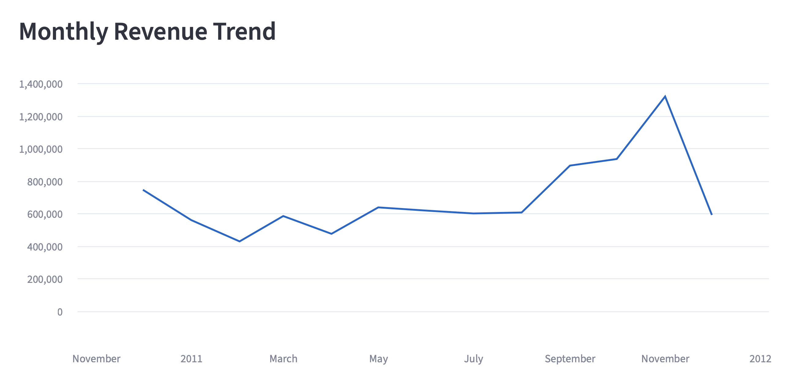
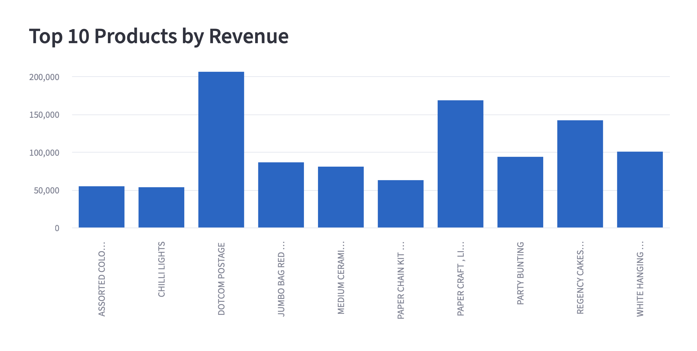
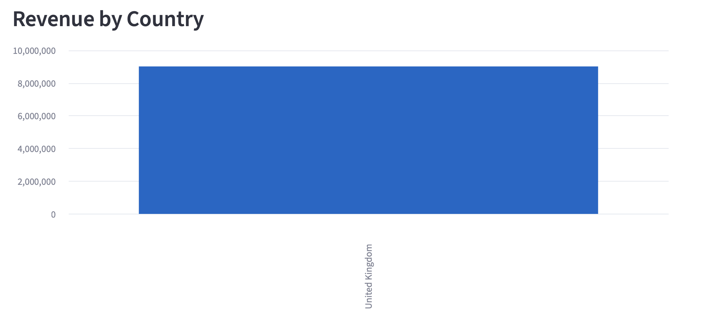

# Business Analytics & Digital Transformation

## Project Overview

An end-to-end retail business analytics project using Python, pandas, SQL and Streamlit to transform transaction data into actionable business insights.

The project demonstrates how businesses can use data cleaning, exploratory analysis, interactive dashboards and performance metrics to support more informed operational and strategic decisions.

## Dashboard Preview

This interactive Streamlit dashboard analyses real retail transaction data to explore revenue trends, product performance and geographical markets.

### Monthly Revenue Trend


### Top 10 Products by Revenue




### Revenue by Country


The dashboard also includes interactive country filtering and key business metrics, including total revenue, total orders and units sold.

## Business Problem

Retail businesses need reliable information about revenue, sales trends, product performance and geographical markets.

Without structured analysis, it can be difficult to identify growth opportunities, compare performance and make evidence-based decisions.

This project explores how a data-driven reporting workflow can improve visibility into business performance.

## Technologies Used

- Python
- pandas
- SQL and SQLite
- Streamlit
- Matplotlib
- Microsoft Excel and CSV
- PyCharm
- Git and GitHub

## Dataset

The project uses the UCI Online Retail dataset, containing transaction records from a UK-based online retailer.

The analysis includes transaction dates, product descriptions, quantities, prices and customer countries.

The repository also includes a small synthetic dataset used for initial development and testing.

## Project Workflow

1. Import and inspect the retail transaction data.
2. Identify missing values, cancellations and invalid transaction records.
3. Prepare a cleaned dataset for analysis.
4. Calculate business performance metrics.
5. Explore revenue trends, products and geographical markets.
6. Use SQL to query sales data.
7. Develop an interactive Streamlit dashboard.
8. Interpret findings to support business decision-making.

## Dashboard Features

The Retail Business Intelligence Dashboard includes:

- Interactive country filtering
- Total revenue
- Total orders
- Units sold
- Monthly revenue trends
- Product performance analysis
- Business performance visualisations

## Business Value

The dashboard demonstrates how analytical tools can help organisations:

- Monitor commercial performance
- Identify high-performing products and markets
- Understand changes in revenue over time
- Improve access to business information
- Support evidence-based strategic discussions

Revenue alone does not establish profitability. Further analysis of costs, margins and customer behaviour would be needed before making investment decisions.

## How to Run

Install the dependencies:

```bash
python -m pip install -r requirements.txt
```

Launch the dashboard:

```bash
python -m streamlit run real_dashboard.py
```

The application will open locally in a web browser.

## Future Improvements

- Introduce automated data validation
- Add customer segmentation and RFM analysis
- Investigate repeat-purchase behaviour
- Build revenue forecasting models
- Explore opportunities for automated reporting

## Author

Ella Hughes

MSc Computer Science (Conversion) student at the University of Birmingham.

GitHub: https://github.com/Ella-Hughes

LinkedIn: https://www.linkedin.com/in/ella-hughes-cs
